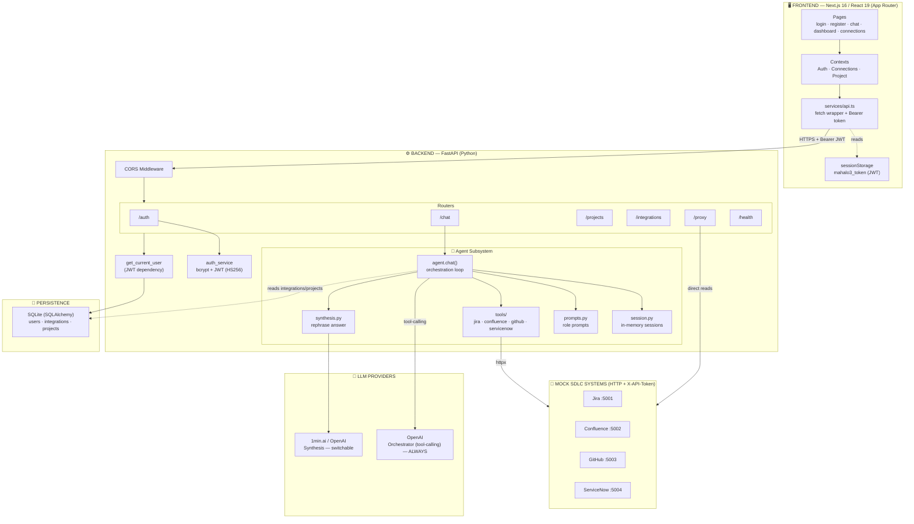
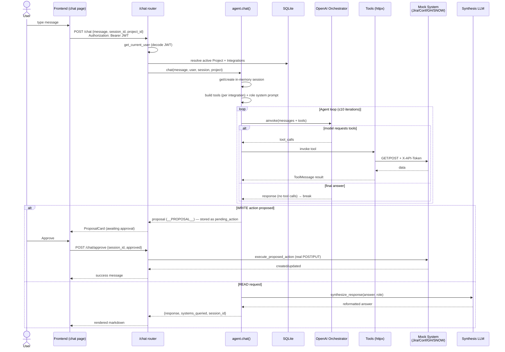
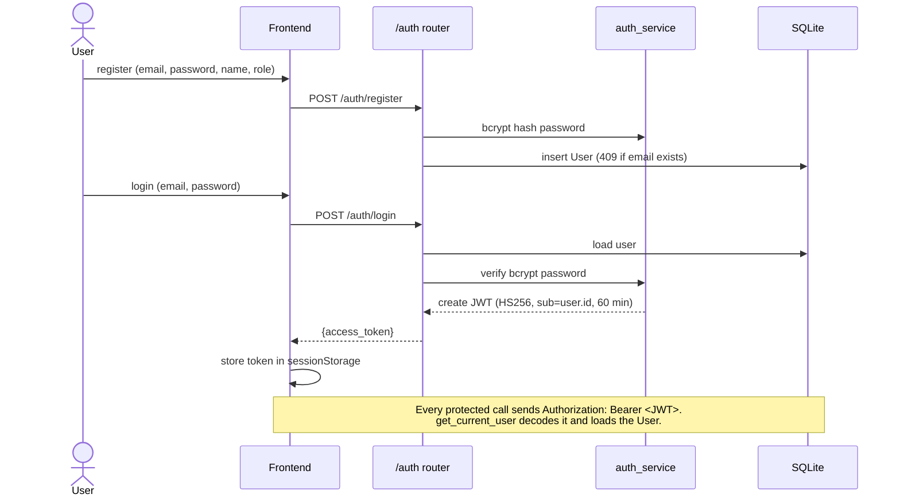

# MAHALO3 — Architecture & System Flow

MAHALO3 is an AI-powered, multi-persona SDLC assistant. A Next.js frontend talks to a FastAPI backend, which runs a LangChain agent that orchestrates OpenAI (for tool-calling) plus a switchable synthesis LLM, calling out to four mock SDLC systems (Jira, Confluence, GitHub, ServiceNow).

## High-Level Architecture

## Chat / Agent Request Flow (the core loop)

## Authentication Flow

## Component Responsibilities

### Frontend — Next.js 16 / React 19 (App Router)
- **Pages** (`src/app`): public `login` / `register`, and a `(protected)` route group guarding `chat`, `dashboard`, `connections`.
- **Contexts**: `AuthContext` (token restore/login/logout), `ConnectionsContext`, `ProjectContext`.
- **`services/api.ts`**: thin `fetch` client; injects `Authorization: Bearer <token>` from `sessionStorage`, normalizes FastAPI errors. Base URL `NEXT_PUBLIC_API_URL` (default `http://localhost:8008`).

### Backend — FastAPI
- **`main.py`**: builds the app, adds CORS, registers routers, and on startup runs `init_db()` + `validate_llm_config()`.
- **Routers**: `/auth` (register/login/me + `get_current_user`), `/chat` (agent entry, suggestions, approve), `/projects` (CRUD, proposal, sync, bootstrap mock data), `/integrations` (CRUD + test), `/proxy` (direct authenticated reads of mock systems), `/health`.
- **`auth_service.py`**: bcrypt hashing + python-jose JWT (HS256).
- **Models** (SQLAlchemy over SQLite): `User`, `Integration` (per-user external system URL + token), `Project` (cross-system link keys).

### Agent Subsystem (`app/agent`)
- **`agent.py`**: the AI core — builds tools from the user's integrations, runs the OpenAI tool-calling loop (≤10 iterations), detects write proposals, hands off to synthesis, and executes approved actions.
- **`session.py`**: in-memory sessions (`_sessions` dict) holding message history and a single `pending_action`. Not persisted.
- **`synthesis.py`**: rephrases the orchestrator's answer via the switchable provider; falls back to the raw answer on failure.
- **`onemin_llm.py`**: custom LangChain chat model wrapping 1min.ai's `/api/chat-with-ai` (no function calling — synthesis only).
- **`prompts.py`**: base rules + role-specific prompts (product_manager / developer / executive).
- **`markup_utils.py`**: parses text-emitted tool calls and strips tool markup from user-facing text.
- **`demo_agent.py`**: keyword-based fallback when no OpenAI key is configured.
- **`tools/`**: factories returning LangChain tools bound to an integration's URL + token, calling mock services over httpx with `X-API-Token`.

## Key Architectural Decisions

- **Dual-LLM split.** The orchestrator is *always* OpenAI because it needs native function calling to decide which tools to invoke. Synthesis (final phrasing) is a switchable provider (`onemin` by default, falling back to OpenAI). This separates the reasoning brain from the presentation layer.

- **Propose-and-confirm writes.** Read operations execute immediately, but any write (create story, update story, create branch, create incident) returns a `__PROPOSAL__` sentinel instead of executing. The proposal is held on the session's `pending_action` and only runs after the user approves via `/chat/approve`. This is the human-in-the-loop safety gate.

- **Dynamic tool wiring.** On each request, `agent.chat()` reads the user's `Integration` rows and builds tools bound to each integration's URL + token. A user only gets Jira tools if they've connected Jira.

- **Two paths to the mock systems.** The agent tools (LLM-driven, read + write) and the `/proxy` routes (direct authenticated reads the dashboard uses without invoking the agent).

- **In-memory sessions.** Conversation history and pending actions live in a process-level dict, not the DB. Restarting the backend clears all conversations — a deliberate PoC tradeoff. The DB persists only users, integrations, and projects.

- **Stateless auth.** JWT (HS256, `sub=user.id`, 60-min expiry) stored in `sessionStorage`, sent as a Bearer token on every call, decoded by the `get_current_user` dependency on protected routes.

## External Systems

| System | Default Port | Reads | Writes (via proposal) |
|--------|--------------|-------|-----------------------|
| Jira | :5001 | projects, stories, sprints, boards, developers | create/update story |
| Confluence | :5002 | spaces, pages, search | — (read-only) |
| GitHub | :5003 | repos, PRs, commits, stats | create branch |
| ServiceNow | :5004 | deployments, incidents, stats | create incident |

Plus the LLM providers: **OpenAI** (orchestrator, mandatory) and **1min.ai** (default synthesis, switchable to OpenAI).
